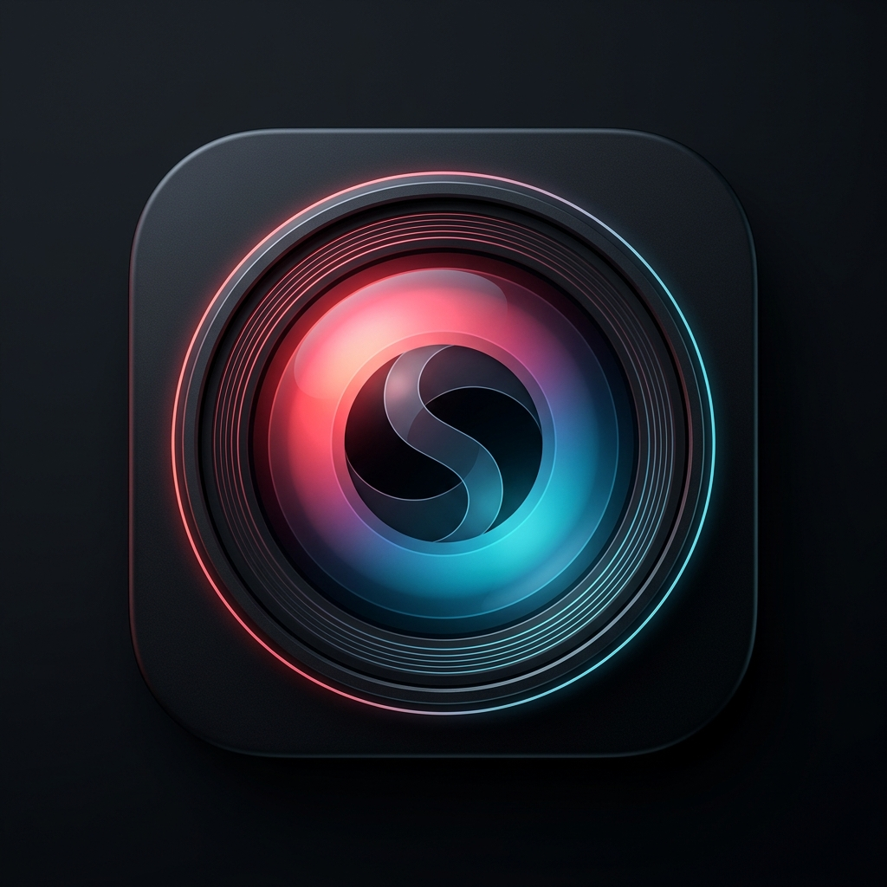

  

# 📸 CameraS - Advanced Infrared (IR) Camera

**Kameras** is a custom Android camera application designed specifically for near-infrared (NIR) photography enthusiasts. It provides real-time color correction to balance out aggressive color casts caused by specialized filters like **Kolari IRChrome**, **590nm (Gold)**, or other IR-pass filters directly on your live preview screen[cite: 1].

---

## ✨ What's New in Version 4.0

* **Hardware ISP Color & Contrast Engine in Manual Mode:**
  * **Normalized RGGB Gains:** Eliminates unintended digital overexposure and highlight clipping when switching from Auto to Manual white balance.
  * **3x3 Color Correction Matrix (`COLOR_CORRECTION_TRANSFORM`):** Preserves and enhances sensor-calibrated color separation with real-time **Saturation** control (`0.50x – 2.00x`).
  * **Hardware S-Curve Tonemapping (`TONEMAP_CURVE`):** Delivers crisp shadows and punchy contrast (`0.60x – 1.80x`) directly on the camera ISP in both live preview and full-res captures.
  * **Exposure Compensation (EV):** Hardware AE compensation slider for bright infrared foliage.
* **Modern Pro Camera UI:**
  * Edge-to-edge dark HUD with segmented **AUTO / WB Seçici / MANUEL** mode switcher, live Kelvin/Tint/Contrast/Saturation telemetry, 3x3 Rule-of-Thirds grid toggle, gradient spectrum sliders with `-` / `+` fine-step controls, preset modal saving, and concentric pro shutter button.
  * **One-Tap Auto Lock:** Capture Auto mode's measured Kelvin & Tint into Manual sliders with a single tap.

---

## 📱 Core User Features

### 🎛️ Advanced White Balance Control
* **Auto Mode:** Instantly switch to standard automatic mode to let the camera handle environment lighting seamlessly[cite: 1].
* **Manual Overrides:** Take absolute control over your infrared look using manual **Kelvin (1K - 10,000K)** and **Tint (-100 to +100)** sliders to eliminate harsh red or blue color casts[cite: 1].

### 🎯 Interactive WB Picker
* **Spot Sampling:** Tap the **WB Picker 🎯** button and touch any area on the live preview that should be neutral white or gray under normal conditions[cite: 1].
* **Instant Calibration:** The app captures a 25x25 pixel sample at that exact coordinate, runs an immediate inverse calculation on the raw sensor data, and balances out the infrared color shift instantly[cite: 1].

### 💾 Custom Filter Presets
* **Save Configurations:** Found a perfect color profile for a specific lighting or filter look (e.g., *IRChrome Aerochrome look* or *590nm Golden Leaf effect*)? Type a name and save it directly into your library[cite: 1].
* **Quick Access:** All your saved presets are listed in a clean, horizontal scrollable row right on the interface for effortless swapping[cite: 1].
* **Easy Management:** Tap any preset card to **instantly load** your configurations[cite: 1]. **Long-press** any card to safely remove it from your saved library[cite: 1].

### 🖼️ True-to-Sensor Live Preview
* **Zero Image Distortion:** No more stretched, squished, or squeezed preview screens[cite: 1]. The app dynamically calculates your device's exact hardware camera sensor aspect ratio and applies a precise matrix transformation to keep your composition geometrically perfect[cite: 1].

### 📸 Seamless Capture & Direct Export
* **Max Resolution JPEGs:** Snap photographs utilizing the full resolution and dimensions provided by your device's camera hardware[cite: 1].
* **Audio Feedback:** Plays the crisp, native system camera shutter click sound asynchronously every time you hit capture so you know your shot went through[cite: 1].
* **Direct Gallery Saving:** Captured images are immediately written to your phone's external shared storage via MediaStore, meaning they appear straight in your photo gallery without any quality loss[cite: 1].

---

## 🕹️ Quick Interface Guide

> 💡 **Pro-Tip:** For the best infrared aesthetic, don't just blindly move sliders. Frame your shot, find a brightly glowing leaf or grass patch (which glows white in IR), and use the **WB Picker 🎯** to tap on it for perfect immediate calibration!

1. **Toggle Modes:** Use the **Auto**, **Manual**, or **WB Picker** buttons at the top to change how the camera calculates color[cite: 1].
2. **Fine-Tune:** Slide the Kelvin or Tint bars at the bottom to tweak your colors manually once Manual mode is selected[cite: 1].
3. **Save Your Look:** Type an easily recognizable name (e.g., `Sunny-590nm`) in the text field and click **Save**[cite: 1].
4. **Shoot:** Hit the central **Capture** button to freeze your perfectly color-corrected infrared view[cite: 1].

Without App;

IRCHROME FİLTER

590nm FILTER

720nm FILTER

With App;

IRCHROME FİLTER

590nm FILTER

720nm FILTER

